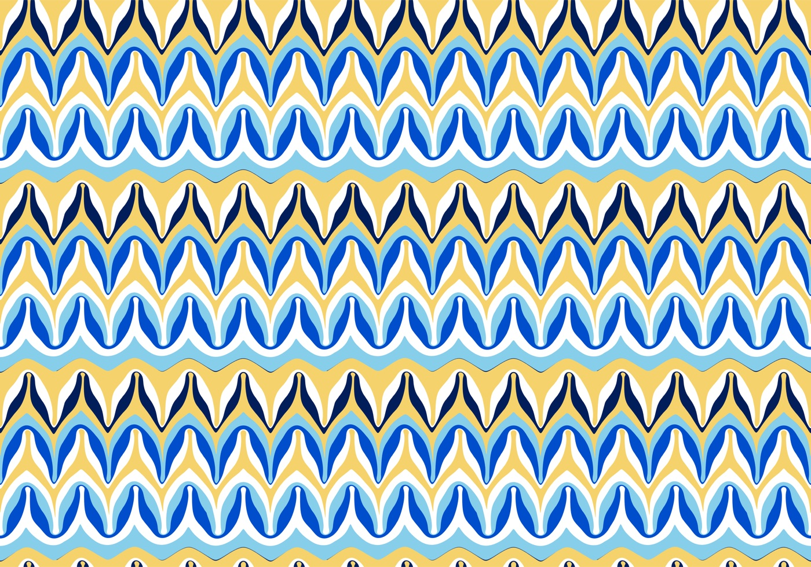
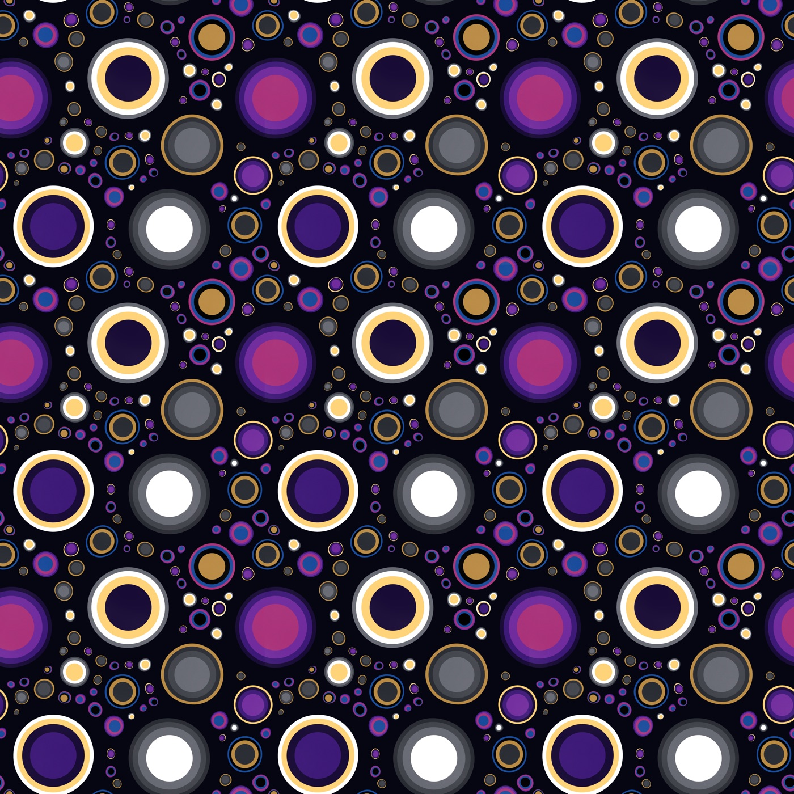
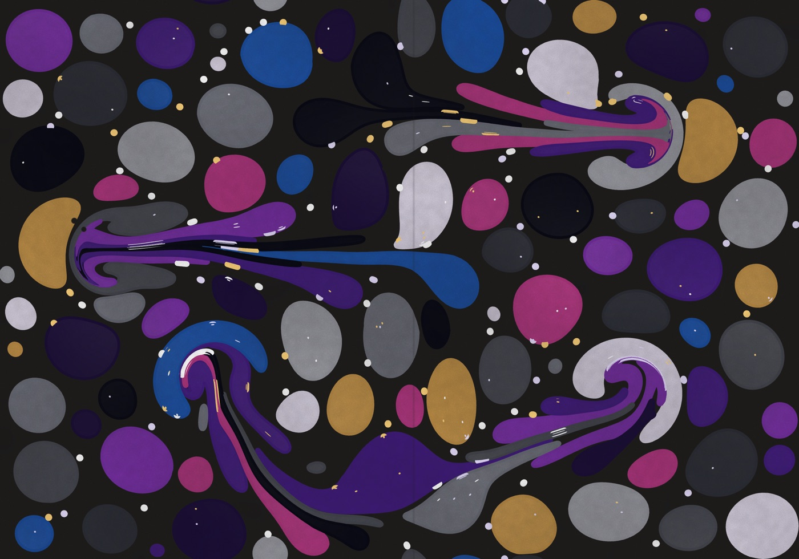

# Marbler

**Ink marbling in your browser.** Drop ink on a virtual bath, comb it into patterns, and pull a print.


**Demo:** coming soon · **[How it works](how-it-works.html)** · **[Roadmap](ROADMAP.md)** · **[Sources](BIBLIOGRAPHY.md)**

| | | |
|---|---|---|
|  |  |  |
|  |  |  |

## Try it

You need [Node](https://nodejs.org). Build the editor once, then start the local server:

    cd app && npm install && npm run build && cd ..
    node server.mjs

Then open http://127.0.0.1:8000. The original editor is kept, as it was, at http://127.0.0.1:8000/classic/; it needs no build.

## What it does

- **Seven simulators:** from the original closed-form maths (Classic) to a moving bath (Wake) and a full fluid solve on the GPU (Grid ink). All of them take the same tools and scripts.
- **Real marbling tools:** drops, spray, stripes, rakes, combs, stylus, stir, jiggle, vortex and air, plus an eraser, Hearts and freezing chosen ink in place.
- **Seamless repeats:** make the tank a tile, straight, brick or half-drop, and exports join up.
- **Prints:** PNG, SVG, a 3000 pixel print, and a simulated paper pull.
- **Scripts:** every pattern can be a short script, your hand session can be copied into one, and a script can play on top of ink already in the tank.

| Simulator | The idea |
|---|---|
| Classic | Closed-form maps, after pst-marble. Each drop pushes everything. |
| Spreading | Ink grows over bare water until it meets other ink. |
| Thin film (beta) | Each ink can claim a limited area, which gives even rings. |
| Film | Ink carries pressure and water doesn't, so films ignore each other until they touch. |
| Wake | Film in a bath that keeps moving, so ink coasts and curls. |
| Wake (fast) | The same as Wake, drawn in the background so busy tanks keep moving. |
| Grid ink (beta) | Colour on a grid, moved by a full fluid solve (BiMocq²). Soft blends and long flows. |

[How it works](how-it-works.html) explains all of it in one place: the maths, every tool, and every script command. It's also linked from the app.

## Scripts

```js
const { bath: water, inks } = palette('Lapis & Gilt');
bath({ color: water });
tile({ on: true });
fillDots({ count: 80, colors: inks, gap: 0.6 });
settle();
hearts({ angle: 270 });
```

Scripts are real JavaScript that runs in the page, so only run ones you trust.

## The assistant (optional)

The assistant writes and edits scripts from a description. It needs an OpenAI API key and runs on your own computer only:

1. Put `OPENAI_API_KEY=...` in a file called `.env.local`, in the folder above this one.
2. Run `node server.mjs`.

The key stays in that local server and never reaches the browser. It's worth using a separate key with a monthly spend limit. **Don't host `server.mjs` publicly:** it has no login or rate limit, so strangers could spend your key.

## Host your own demo

    npm install
    (cd app && npm install)
    npm run build

This writes a static site to `dist/`: the editor at the top, the classic editor in `classic/`, and How it works. The assistant's script writing and the timing recorder are left out, and any static host can serve it. `wrangler.jsonc` sets it up for Cloudflare (`npm run deploy`), and `vercel.json` for Vercel; both hosts get the same security headers, written into `dist/_headers` for Cloudflare. `npm run preview` serves the build locally with those same headers.

## Develop

    node --test *.test.mjs

The editor is React, Tailwind and Vite, in `app/`: `npm run dev` there serves it with live reloading, `npm test` checks that nothing from the classic page was left behind, and `npm run storybook` shows every part on its own. `app/README.md` explains how to add a tool, setting, menu action or panel. The simulators and the classic page need no build: `node server.mjs` serves them as they are. Where to look:

| Files | What's there |
|---|---|
| `engine.js` | Classic and Spreading, the timeline, and everything the simulators share |
| `film.js`, `thinfilm.js`, `wake.js`, `wakefast.js`, `drawworker.js` | The other outline simulators |
| `gridink.js`, `gridgl.js` | Grid ink, on the CPU and on the GPU |
| `tile.js` | The maths of repeating tanks |
| `models.js` | The list of simulators |
| `api.js` | Every script command. The assistant's instructions and the reference on the How it works page are generated from it |
| `tools.js`, `info.js` | The sidebar tools and the text behind each (i) |
| `controller.js`, `tankview.js`, `pageactions.js` | The tank's controller, its view, and page actions (saves, prints, exports), shared by both editors |
| `app/` | The editor |
| `classic/` | The original editor, kept as it was |
| `server.mjs` | The local server and the assistant |

## License

[Apache 2.0](LICENSE), so you can use it commercially as long as you keep the notices.

Marbler began as a modified JavaScript reimplementation of [pst-marble](https://ctan.org/pkg/pst-marble) by Aubrey Jaffer (LPPL 1.3c), and part of its code is still derived from that package, under conditions that apply if you reuse it. Its authors don't support Marbler. [`NOTICE`](NOTICE) has the details, and [`BIBLIOGRAPHY.md`](BIBLIOGRAPHY.md) lists every source.

By Ilse Funkhouser, written with [Claude](https://claude.com/claude-code).
